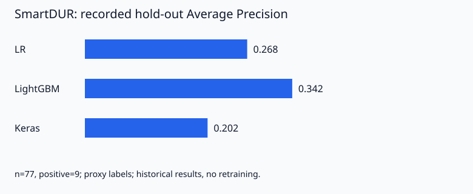

# AI Healthcare Portfolio

전봉우의 AI 헬스케어 부트캠프 분석·모델링 포트폴리오입니다. 건강검진 데이터 탐색, 난임 시술 결과 예측, 약물 경고 우선순위 검토의 **Python 코드와 Jupyter Notebook**을 공개합니다. 입력 데이터와 행별 실행 출력은 저장소에 포함하지 않습니다.

## 프로젝트

| 프로젝트 | 문제와 방법 | 코드 | 기록된 결과 |
|---|---|---|---|
| [흡연 건강검진 EDA](projects/smoking-health-eda/) | 흡연 여부에 따른 건강 지표 탐색, 결측치 처리, Welch t-test, 보조 로지스틱 회귀 | [Notebook](projects/smoking-health-eda/notebooks/analysis.ipynb) | 저장된 통계표·집계 그래프·보조 분류 정확도 0.699 (결측치 대체의 누수 한계 있음) |
| [난임 예측](projects/infertility-prediction/) | 시술 정보로 임신 성공 여부 예측, fold 내부 전처리, XGBoost·CatBoost 비교 | [Notebook](projects/infertility-prediction/notebooks/analysis.ipynb) | 과거 CV 평균 ROC-AUC: XGB 0.738193, CatBoost 0.737818, 평균 앙상블 0.738298 |
| [SmartDUR](projects/smartdur-medication-alert/) | 중요 약물 경고 우선순위 검토, 환자·시간 분리, LR·LightGBM·Keras 비교 | [Notebook](projects/smartdur-medication-alert/notebooks/analysis.ipynb) · [Python 모듈](projects/smartdur-medication-alert/src/) | 과거 LR 개발 OOF AP 0.260, hold-out AP 0.268; hold-out 양성 9건 |

수치는 기존 실행 산출물에 저장된 값입니다. 이번 코드 공개 작업에서는 모델을 재학습하지 않았습니다. 서로 다른 데이터·지표의 점수를 직접 비교하지 않으며, 임상 배포나 의료 효과를 검증한 결과로 해석하지 않습니다.



## 노트북 결과 확인

세 프로젝트의 Notebook을 GitHub에서 열면 원본에 저장된 **성능표·통계 요약·집계 그래프**를 바로 볼 수 있습니다. 공개용으로 검토한 21개 코드 셀의 출력 30개를 복원했습니다. 행별 미리보기·개별 예측 배열·개인 경로·설치 로그는 제외했습니다.

이 결과는 과거 원본 실행의 기록입니다. 이번에 전체 노트북을 재실행한 것은 아니며, 실행 번호도 원본 값을 유지해 현재 셀 순서와 일치하지 않을 수 있습니다. SmartDUR의 Plotly 그래프는 같은 저장 집계 trace를 PNG로 변환해 표시합니다. 데이터 없이 결과를 열람할 수 있지만 재계산에는 로컬 입력과 의존성이 필요합니다. [출력 검토 기록](docs/notebook-output-review.json)에 원본 셀 번호와 검토 해시를 남겼습니다.

## 저장소 구성

```text
projects/
├── smoking-health-eda/             # 개인 EDA Notebook·집계 차트
├── infertility-prediction/         # 팀 모델 비교 Notebook
└── smartdur-medication-alert/
    ├── notebooks/analysis.ipynb    # 분석 실행 순서와 결과 표시 코드
    └── src/
        ├── run_analysis.py        # 데이터 분할·모델링·평가
        ├── label_audit.py         # 라벨 연결 근거 감사
        └── chart_layout.py        # 집계 그래프·HTML 보고서
studies/                           # ML·DL·CV·NLP 학습 주제 메모
docs/                              # 출처·분석 한계·공개 검사 기록
tools/                             # Git index 공개 대상 검사
tests/                             # 데이터 없이 실행하는 가벼운 테스트
```

각 프로젝트에 README, 실제 코드에서 확인한 requirements, 데이터를 직접 준비하는 방법이 있습니다. 집계 지표와 대표 차트는 `assets/`에 보존했습니다. 원시 CSV/XLSX·의료 이미지·개별 예측·내부 검토 기록·학습 모델은 제외합니다.

## 기술 스택과 역할

Python, pandas, NumPy, SciPy, scikit-learn, Matplotlib, Seaborn, XGBoost, CatBoost, LightGBM, Keras/PyTorch, SHAP, Plotly를 사용합니다. Windows·VS Code·Jupyter·Colab·Conda에서 작성된 자료를 상대경로와 환경변수 중심으로 정리했습니다.

흡연 프로젝트는 개인 명의 최종 노트북에 근거합니다. 난임 프로젝트는 5조 팀 코드이며 개인별 기여 범위는 자료만으로 확정하지 않았습니다. SmartDUR는 전봉우 담당 분석·모델링 절차 문서와 모델링 구현에 근거하며, 팀 전체 기획·서비스 결과를 개인 단독 성과로 표시하지 않았습니다.

## Windows PowerShell에서 시작하기

Python **3.14, 64비트 CPython**를 기준으로 준비했습니다. 로컬 확인 환경과 난임 실행 기록은 3.14.2이며 SmartDUR 노트북은 3.14.6을 기록합니다. [환경 문서](docs/environment.md)에 고정 버전과 실제 확인 범위를 적었습니다. 패키지 메타데이터 확인과 모델 전체 재현은 별개입니다.

```powershell
git clone https://github.com/qhddn2643/AI-HealthCare.git
cd AI-HealthCare
code .
python -m venv .venv
.\.venv\Scripts\Activate.ps1
python -m pip install --upgrade pip
python -m pip install -r requirements-dev.txt

# 실행할 프로젝트 하나를 선택합니다.
$project = 'smoking-health-eda'
# $project = 'infertility-prediction'
# $project = 'smartdur-medication-alert'
python -m pip install -r "projects/$project/requirements.txt"
python -m ipykernel install --user --name healthcare-portfolio --display-name "Healthcare Portfolio"
```

활성화가 차단되면 정책을 변경하지 않고 `.\.venv\Scripts\python.exe -m pip ...`처럼 직접 실행할 수 있습니다. VS Code의 `Python: Select Interpreter`와 Notebook 오른쪽 상단 Kernel에서 같은 환경을 선택합니다. 기존 Conda 환경은 해당 환경에서 requirements를 설치하고 그 인터프리터/Kernel을 선택합니다. 프로젝트 간 의존성 충돌이 있으면 별도 환경으로 분리하세요.

## 데이터 준비와 실행

각 프로젝트의 `data/README.md`를 읽고 승인된 데이터를 **로컬에만** 준비합니다. 데이터가 없으면 전체 분석을 실행할 수 없습니다. 소스와 기록된 집계 결과는 데이터 없이 열어 검토할 수 있습니다.

노트북은 해당 프로젝트 또는 그 `notebooks` 폴더를 작업 경로로 열고 위에서 아래로 실행합니다. 기본 `ALLOW_TRAINING=False`이므로 학습 셀에서 중단됩니다. 학습 범위와 비용을 확인한 뒤 직접 `True`로 변경합니다. SmartDUR는 추가로 `SMARTDUR_ALLOW_TRAINING=1`이 필요합니다.

```powershell
# SmartDUR: 패키지를 준비하고 직접 전체 CPU 학습을 실행할 때만 사용
cd projects/smartdur-medication-alert
$env:SMARTDUR_ALLOW_TRAINING = '1'
python src/run_analysis.py
Remove-Item Env:SMARTDUR_ALLOW_TRAINING
```

흡연·난임은 `HEALTHCARE_DATA_DIR`, SmartDUR는 `SMARTDUR_PACKAGE_DIR`·`SMARTDUR_ARCHIVE`로 입력 위치를 설정할 수 있습니다. 실행 중 생성되는 SmartDUR 보고서·개별 검토 기록·모델과 난임 제출 파일은 무시되는 `outputs/`에 저장합니다. 계산식·분할·모델 설정은 원본을 유지했으며 예측 결과를 바꾸는 개선 실험은 수행하지 않았습니다.

## 검증과 변경 관리

```powershell
# 저장소 루트에서 실행. 모델 학습이나 실제 의료 데이터가 필요하지 않습니다.
python -m unittest discover -s tests -v
python tools/check_publication.py
git status --short
git diff --check
```

공개 검사 도구는 Git index에 포함될 파일을 검사합니다. 검토 기록과 해시가 일치하는 집계 출력만 허용하며 새 출력이나 변경된 출력은 재검토 전까지 거부합니다. 변경을 stage한 뒤 실행하면 다음 커밋 후보를 확인할 수 있습니다.

```powershell
git switch -c docs/update-portfolio
git add README.md projects docs tools tests
python tools/check_publication.py
git diff --cached --check
git diff --cached --stat
git diff --cached
git commit -m "docs: update healthcare portfolio"
git push -u origin HEAD
```

[검증 기록](docs/validation-report.md), [분석 한계](docs/analysis-review.md), [공개 범위](docs/publication-review.md), [전체 파일 목록](docs/upload-manifest.md), [원본 대응표](docs/source-manifest.json)를 제공합니다. 팀 코드의 출처를 유지했으며 코드와 자료 전체에 일괄 오픈소스 라이선스를 부여하지 않았습니다.
