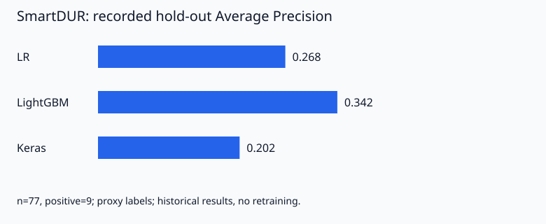

# SmartDUR: 약물 안전 경고 우선순위 검토

## 프로젝트 개요

중요 약물 경고를 먼저 확인하도록 돕는 교육용 팀 프로젝트입니다. 전봉우 담당 분석·모델링 절차 문서와 `modeling_analysis` 구현을 기준으로 정리했습니다. 전체 서비스 기획·규칙·임상 라벨 정의는 팀 결과이며 개인 단독 기여로 표시하지 않습니다.

## 문제 정의와 목표

공식 안전 규칙을 유지하면서 남은 경고의 상대적 우선순위를 검토합니다. 출력은 처방 변경이나 임상 판단을 자동 수행하지 않습니다.

## 데이터 출처 및 특징

팀 내부 MAIN 458건(중요 경고 60건), X35 입력, MASTER 1,030건입니다. 대리 라벨과 의료 특성이 포함되며 원 출처·공개 허가가 확인되지 않아 전체 원자료·가상 EMR·개별 예측·모델을 제외했습니다. [승인된 데이터 준비](data/README.md).

## 전처리 및 EDA

중앙값 대체·표준화·원-핫 인코딩을 학습 fold에서 수행합니다. 경고문장 문자 TF-IDF/SVD도 훈련 부분에서만 학습합니다. 라벨 연결 감사와 전문가 재판정 대기를 구분합니다.

## 모델링 또는 분석 방법

LR·LightGBM은 X35, Keras는 X35와 텍스트를 사용합니다. Keras는 PyTorch CPU 백엔드이며 내부 환자 분할로 epoch를 선택합니다. 입력 정보가 달라 순수 알고리즘 비교는 아닙니다.

## 평가 방법 및 결과

마지막 2개월 77건(양성 9건)을 hold-out으로 두고, 같은 환자의 과거 4건을 제외해 개발 377건(양성 50건)을 사용합니다. 개발 집단은 StratifiedGroupKFold 5-fold이며 시간순 CV는 아닙니다. 환자 단위 부트스트랩 2,000회의 기록된 AP입니다.

| 모델 | 개발 OOF AP [95% CI] | hold-out AP [95% CI] |
|---|---|---|
| LR | 0.260 [0.174, 0.392] | 0.268 [0.086, 0.549] |
| LightGBM | 0.258 [0.174, 0.394] | 0.342 [0.111, 0.673] |
| Keras | 0.202 [0.134, 0.317] | 0.202 [0.091, 0.427] |



[집계 지표 원값](assets/recorded-metrics.json)은 기존 CSV에서 선별했습니다. 이번 작업에서 학습하지 않았습니다.

## 한계점 및 개선 방향

hold-out은 이전에도 조회한 자료라 새로운 독립 외부 검증이 아닙니다. 중요 경고 9건에서 재현율 9/9가 관찰돼도 임상적 무누락을 보장하지 않습니다. 대리 라벨은 전문가 확정 정답이 아니며, 재원기간·유효 처방 수 등의 시점 가용성과 라벨 관찰기간 경계 누수를 추가 검토해야 합니다. 14일 간격 민감도는 주 분석과 구분합니다. 실제 팝업 감소·업무시간 절감·환자 위해 예방 성과는 측정하지 않았습니다.

## 실행 방법

공개한 파일은 [실행 Notebook](notebooks/analysis.ipynb), [모델링·평가](src/run_analysis.py), [라벨 감사](src/label_audit.py), [집계 시각화](src/chart_layout.py)입니다. Notebook 출력은 모두 비웠습니다. 원본 데이터는 포함하지 않으며 [패키지 준비 방법](data/README.md)에 따라 직접 확보해야 합니다.

```powershell
# 저장소 루트에서 의존성 설치
python -m pip install -r projects/smartdur-medication-alert/requirements.txt
cd projects/smartdur-medication-alert
# 승인된 패키지를 data/package/에 풀고 원 ZIP을 data/package.zip으로 준비합니다.
# 비용을 확인하고 전체 CPU 학습을 실행할 때만 설정합니다.
$env:SMARTDUR_ALLOW_TRAINING = '1'
python src/run_analysis.py
Remove-Item Env:SMARTDUR_ALLOW_TRAINING
```

Notebook에서 실행할 때는 해당 프로젝트 또는 notebooks 폴더를 작업 경로로 사용합니다. `ALLOW_TRAINING=True`와 `SMARTDUR_ALLOW_TRAINING=1`을 모두 설정해야 학습합니다. 기본 상태에서는 학습을 중단합니다. Keras는 PyTorch CPU 백엔드를 사용합니다.

패키지 위치는 `SMARTDUR_PACKAGE_DIR`, 검증할 원 ZIP은 `SMARTDUR_ARCHIVE`로 지정할 수 있습니다. 입력 MAIN·MASTER·X35 목록과 원 ZIP의 해시를 확인하며, 라벨 감사에는 패키지의 원본 중재 자료도 필요합니다. 데이터가 없으면 소스·문서·집계 기록만 검토할 수 있습니다.

생성 보고서·검토 기록·연결 토큰·개별 예측·모델은 모두 `outputs/`에 저장되어 Git에서 제외됩니다. 연결 토큰은 재연결이 가능해 익명화로 간주하지 않습니다. 이번 작업에서는 입력 자료를 복사하거나 모델을 재학습하지 않았습니다.

## 사용 기술

Python, pandas, NumPy, SciPy, scikit-learn, LightGBM, Keras, PyTorch, SHAP, Plotly, joblib.
