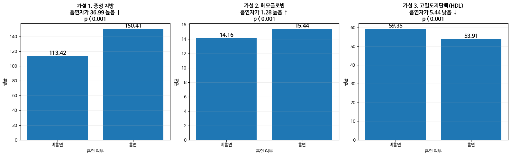

# 흡연 여부와 건강검진 데이터 EDA

## 프로젝트 개요

개인 명의 최종 노트북에서 건강검진 지표를 정리하고 흡연 여부에 따른 차이를 탐색한 작업입니다. 개인 분석 코드와 집계 차트를 정리했으며 팀 전체 발표 성과로 확장하지 않았습니다.

## 문제 정의와 목표

중성지방·헤모글로빈·HDL 등이 흡연 여부에 따라 어떻게 다른지 시각화와 통계 검정으로 살핍니다.

## 데이터 출처 및 특징

교육과정 제공 `smoking_health_data.csv`: 로컬 파일 기준 7,000행·18열입니다. 외부 원 출처와 공개 라이선스가 확인되지 않아 데이터는 제외했습니다. [데이터 준비](data/README.md)를 참고하세요.

## 전처리 및 EDA

BMI·나이·중성지방 구간을 만들고 나이대별 혈압 평균/시력 중앙값, BMI 구간별 중성지방 평균으로 결측을 대체합니다. 분포·박스플롯·상관관계 히트맵을 확인합니다.

## 모델링 또는 분석 방법

흡연/비흡연 집단의 중성지방·HDL·헤모글로빈에 Welch t-test를 적용합니다. 보조 로지스틱 회귀 코드는 원본대로 보존했습니다.

## 평가 방법 및 결과

원본 개인 노트북 코드 셀 45의 집계 평균 비교 차트를 보존했습니다. 모델 성능은 재평가하지 않아 수치로 주장하지 않습니다.

## 한계점 및 개선 방향

결측치 대체가 분리 전 전체 데이터에서 수행되어 보조 예측 모델의 평가 누수 가능성이 있습니다. 탐색·검정과 예측 검증을 분리하고 fold 내부 대체를 적용할 필요가 있습니다. 다중 검정과 나이·성별 등 교란을 함께 고려해야 하며, 집단 차이는 흡연의 인과 효과를 뜻하지 않습니다.

원본 `categorize_age`의 else는 20세 미만도 ‘70대 초과’로 보내고, 중성지방 구간 함수는 400 초과를 명시적으로 처리하지 않습니다. 이 경계값 문제는 기록했으며 기존 결과를 바꾸는 수정은 하지 않았습니다.

## 실행 방법

루트 안내대로 의존성과 데이터를 준비한 뒤 `notebooks/analysis.ipynb`를 위에서 아래로 실행합니다. Linux용 폰트 설치·캐시 삭제 셀을 제거하고 Windows 한글 폰트 설정을 적용했습니다. 모델 학습은 `ALLOW_TRAINING=True`가 필요합니다. 공개 복사본의 출력은 비웠으며 원본은 보존했습니다.

## 사용 기술

Python, pandas, NumPy, SciPy, Matplotlib, Seaborn, scikit-learn.
